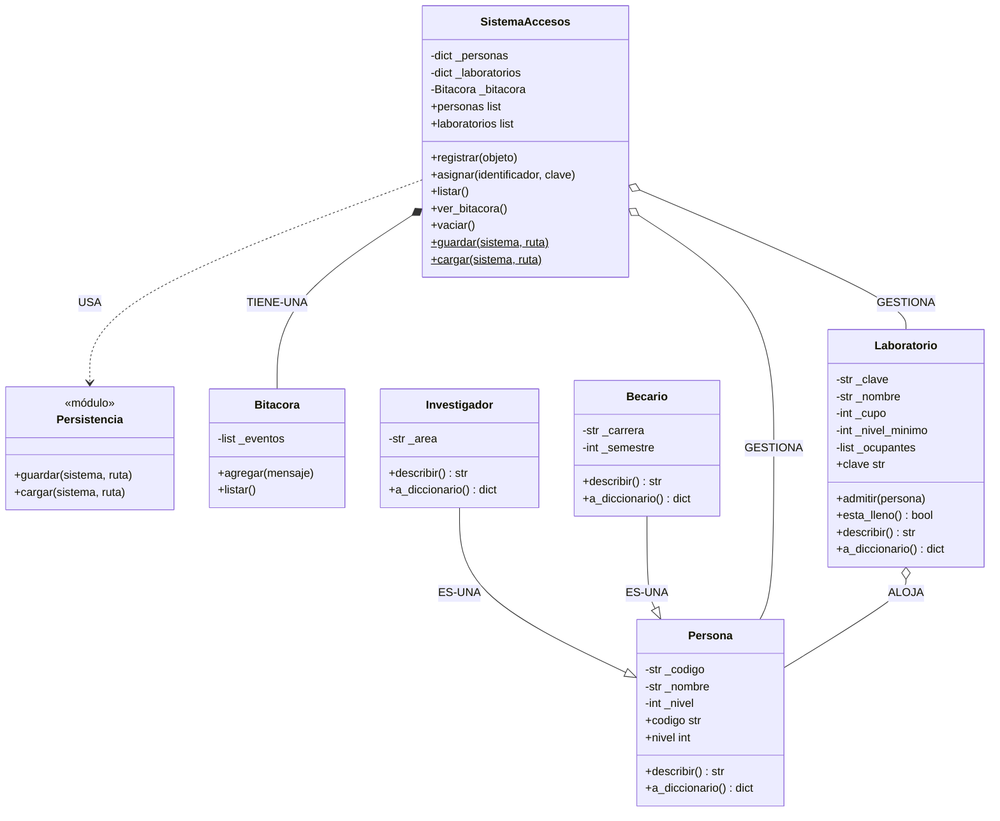

# Control de Acceso para Laboratorio de Ciberseguridad

**Autores:** Vicente Isidro Amezcua Fuentes e Iván Alejandro García Arteaga.
Programación II, Ciclo 2026B. Opción B: control de accesos.

## ¿Qué hace?

Administra quién puede trabajar en los laboratorios de investigación en ciberseguridad. Registra investigadores y becarios con un nivel de autorización de 1 a 3, registra laboratorios con un cupo máximo y un nivel mínimo, y asigna personas a laboratorios validando que exista lugar, que el nivel alcance y que no estén asignadas dos veces. Todo lo que pasa queda en una bitácora y la información se guarda en `datos.json` para que siga ahí al volver a abrir el programa.

## ¿Cómo se corre?

Se necesita Python 3.10 o más reciente, sin librerías externas. Desde la carpeta del proyecto:

```
python main.py
```

Se abre un menú para registrar, asignar, listar y ver la bitácora. Los datos se guardan después de cada operación. Si `datos.json` no existe, el programa arranca vacío.

También se puede usar importando las clases:

```python
from modelo import Investigador, Becario, Laboratorio
from sistema import SistemaAccesos

sistema = SistemaAccesos()
SistemaAccesos.cargar(sistema, "datos.json")
sistema.registrar(Investigador("123456789", "Ana Ruiz", 3, "Análisis de malware"))
sistema.registrar(Becario("987654321", "Luis Paz", 1, "Ciberseguridad", 3))
sistema.registrar(Laboratorio("MAL-01", "Laboratorio de malware", 5, 2))
sistema.asignar("123456789", "MAL-01")
sistema.listar()
SistemaAccesos.guardar(sistema, "datos.json")
```

`guardar` y `cargar` también existen como funciones del módulo `persistencia` con los mismos parámetros.

## ¿Qué hay en cada archivo?

| Archivo | De qué se encarga |
|---|---|
| `excepciones.py` | Errores propios del sistema, todos heredan de `ErrorAccesos` (que a su vez hereda de `ValueError`) |
| `modelo.py` | Clases `Persona`, `Investigador`, `Becario` y `Laboratorio`, con sus validaciones |
| `bitacora.py` | Clase `Bitacora`, el registro cronológico de eventos |
| `sistema.py` | Clase `SistemaAccesos` con `registrar` (personas y laboratorios), `asignar`, `listar`, `guardar` y `cargar` |
| `persistencia.py` | Escribe y lee el estado del sistema en formato JSON |
| `main.py` | Menú de consola para probar el sistema |

## ¿Qué rechaza?

Todo rechazo lanza una excepción con un mensaje que dice qué estuvo mal:

- Código vacío o que no tenga exactamente 9 dígitos, nombre vacío, nivel fuera de 1 a 3, área o carrera vacías, semestre fuera de 1 a 12.
- Registrar algo que no sea una persona o un laboratorio, un código de persona que ya existe o una clave de laboratorio repetida.
- Laboratorio con clave o nombre vacíos, cupo menor a 1, nivel mínimo fuera de 1 a 3 o clave repetida.
- Asignar una persona no registrada, a un laboratorio que no existe, sin el nivel suficiente, a un laboratorio lleno o dos veces al mismo.
- Cargar un archivo dañado: se avisa y el sistema queda vacío.

## Cambios respecto al hito 1

`registrar` da de alta tanto personas como laboratorios, como pide el contrato. Al programar nos dimos cuenta de que el proyecto pide que el sistema tenga la bitácora y le delegue el registro de lo que pasa, así que la `Bitacora` pasó de `Laboratorio` a `SistemaAccesos`; ahora también registra los intentos de asignación rechazados. `guardar` y `cargar` siguen en `persistencia.py`, pero `SistemaAccesos` también los tiene como métodos estáticos con los mismos parámetros para respetar el contrato. Se agregaron `vaciar()` y `ver_bitacora()` al sistema, propiedades de solo lectura (`codigo`, `nivel`, `clave`, `personas`, `laboratorios`) y `a_diccionario()` en `Laboratorio`. Se quitó `listar_ocupantes()` porque `describir()` ya muestra los ocupantes.

## Diagrama

